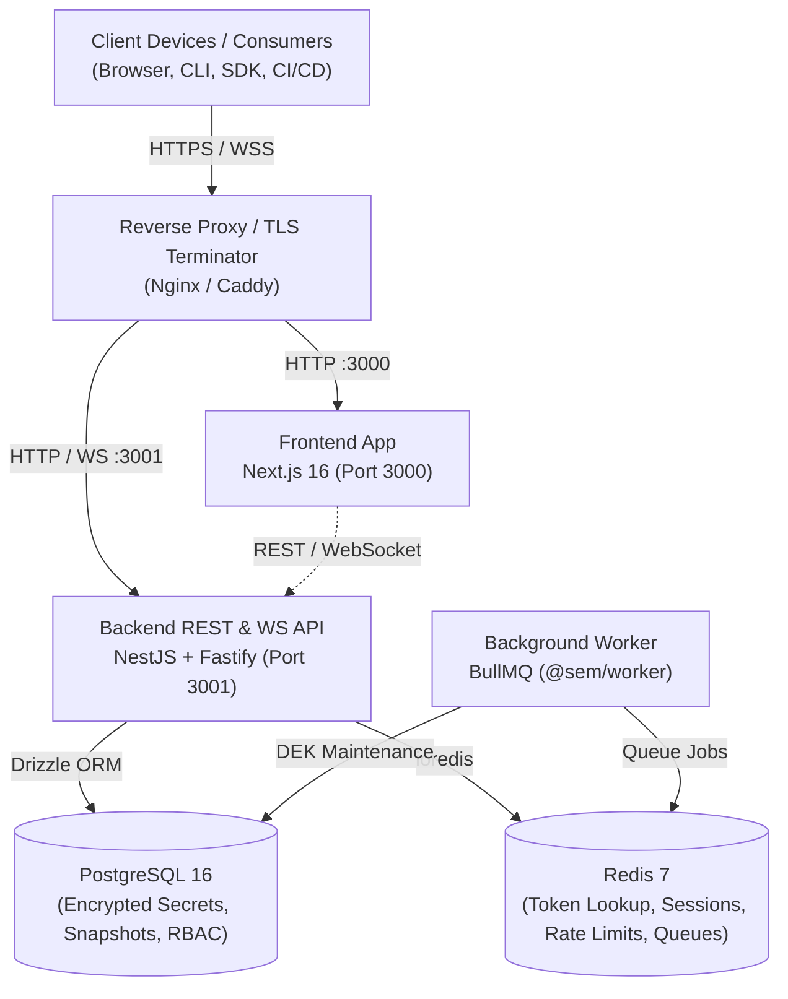
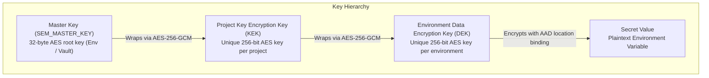
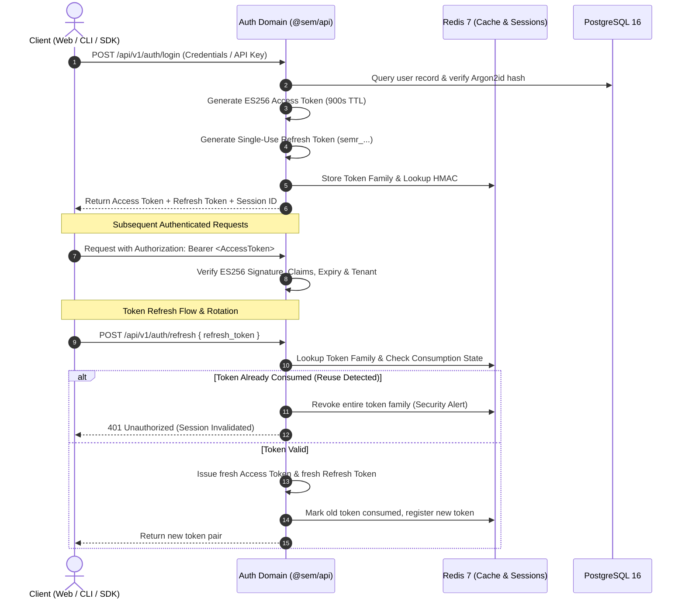
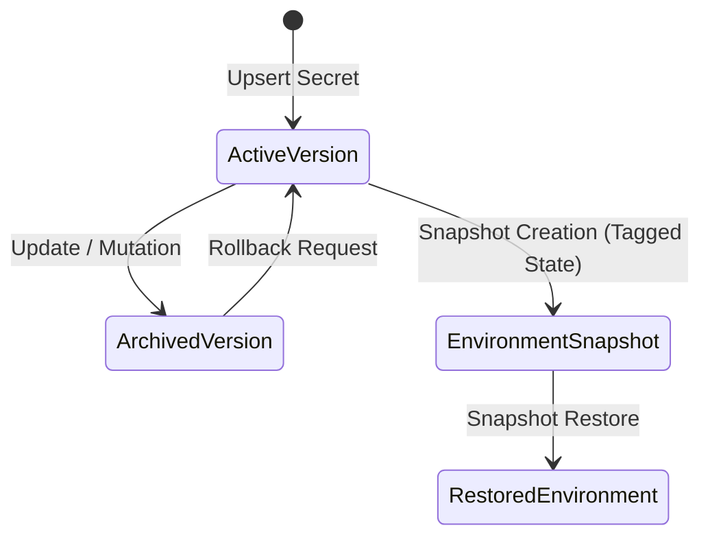

# Architecture Specification — Secure Environment Manager V2

This document provides a comprehensive technical overview of the architecture, security boundaries, cryptographic lifecycle, and data flow of Secure Environment Manager (SEM).

---

## 1. High-Level System Architecture

SEM is architected as a modular, distributed, multi-tenant secrets management system.

---

## 2. Cryptographic Architecture & Key Hierarchy

SEM uses **envelope encryption** based on authenticated AES-256-GCM. Plaintext secret values are never encrypted directly with root credentials.

### Cryptographic Invariants
1. **Authenticated Encryption**: All symmetric operations use `aes-256-gcm` with 128-bit authentication tags. Tampering with ciphertext or authentication tags immediately aborts decryption.
2. **Deterministic Nonces**: Every encryption operation generates a cryptographically random 12-byte (96-bit) initialization vector via `crypto.randomBytes(12)`. Nonces are never reused.
3. **Additional Authenticated Data (AAD)**: Ciphertext is cryptographically bound to its resource coordinates:
   $$\text{AAD} = \text{"sem:secret:"} \parallel \text{orgId} \parallel \text{":"} \parallel \text{projectId} \parallel \text{":"} \parallel \text{envId} \parallel \text{":"} \parallel \text{key} \parallel \text{":v"} \parallel \text{version}$$
   If an adversary copies ciphertext from `production` to `staging` or changes the secret key, decryption fails verification.
4. **Zero Key Exposure**: Plaintext DEK buffers are held in memory only for the duration of the cryptographic operation and wiped with zeroes (`dek.fill(0)`) in `finally` blocks.

---

## 3. Authentication & Token Lifecycle

SEM implements asymmetric authentication via **ECDSA P-256 (ES256)** JWTs combined with opaque, single-use refresh tokens.

---

## 4. API Request & Authorization Pipeline

Every request to `@sem/api` passes through strict defense-in-depth filters:

```mermaid
flowchart LR
    Req[Incoming HTTP Request] --> Throttler[RateLimiter<br/>Sliding Window]
    Throttler --> Helmet[Fastify Helmet<br/>CSP / HSTS]
    Helmet --> Cors[CORS Guard<br/>Strict Whitelist]
    Cors --> JwtGuard[JwtAuthGuard<br/>ES256 Verification]
    JwtGuard --> MustChangePass[MustChangePassword<br/>Enforcement]
    MustChangePass --> PermGuard[PermissionsGuard<br/>RBAC & Scopes]
    PermGuard --> Controller[Domain Controller<br/>Tenant-Isolated Handler]
    Controller --> Audit[AuditService<br/>Immutable Log]
    Audit --> Res[HTTP Response]
```

---

## 5. Secret History, Snapshots & Rollback

1. **Version History**: Secrets maintain an append-only version history. Overwriting a secret increments its version and archives previous encrypted payloads.
2. **Environment Snapshots**: Point-in-time snapshots capture the encrypted state of all variables in an environment, sealed with dedicated snapshot AAD.
3. **Rollback Guarantee**: Restoring an earlier version or snapshot generates a new forward version entry and triggers a cryptographic audit event.

---

## 6. Threat Model & Security Boundaries

| Threat | Mitigation Mechanism |
| :--- | :--- |
| **Database compromise / SQL leak** | Secrets at rest are AES-256-GCM encrypted; keys are never stored in the database. |
| **Ciphertext substitution / moving** | AAD binds ciphertext to tenant, project, environment, key, and version. |
| **JWT algorithm confusion** | Verification strictly enforces ES256 algorithm; HMAC and none algorithms are rejected. |
| **Refresh token theft** | Single-use refresh token rotation with automated family reuse detection. |
| **Cross-tenant data access (IDOR)** | Tenant ID (`orgId`) is derived exclusively from verified JWT identity claims. |
| **Credential brute force** | Redis-backed sliding window rate limiter locks IPs after repeated failures. |
| **Timing attacks** | Constant-time comparisons (`safeCompare`) and dummy Argon2 verification for missing users. |
