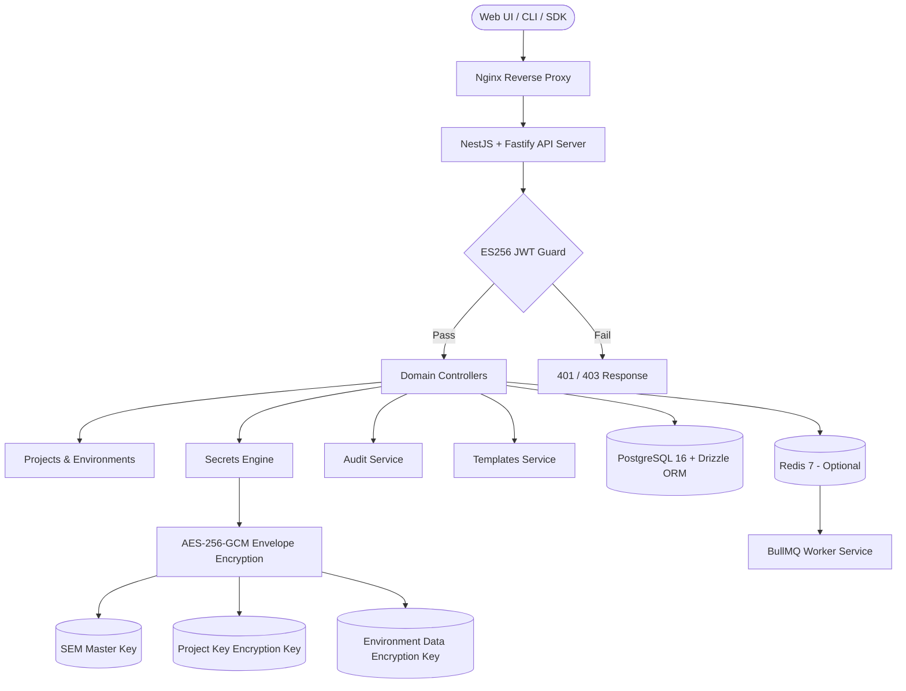

# Architecture (SEM V2)

Secure Environment Manager (SEM) V2 is built as a high-performance, multi-tenant secrets management platform designed for security, auditability, and scalability.

---

## System Architecture

---

## Core Components

### 1. Frontend (`frontend/`)
- **Framework**: Next.js 15 (React 19) with App Router.
- **State & Identity**: React Context (`WorkspaceContext`), session token management, and auto-refresh on 401.
- **Styling & Motion**: Tailwind CSS + Framer Motion.
- **API Client**: `frontend/src/lib/sem-api.ts` typed client consuming JSON envelopes `{ success: true, data: ... }`.

### 2. Backend API (`backend/`, `@sem/api`)
- **Framework**: NestJS 10 on Fastify engine for maximum throughput and minimal overhead.
- **Multi-Tenancy**: Organization isolation enforced at the database query level on every operation.
- **Authentication**: ES256 ECDSA P-256 signed JWTs, Argon2id password hashing, and refresh token rotation with HMAC lookup.
- **Observability**: Prometheus metrics export (`/metrics`) and Pino structured logging.

### 3. Cryptography & Envelope Encryption (`packages/crypto/`, `@sem/crypto`)
- **Envelope Key Hierarchy**:
  1. **Master Key**: 256-bit AES key supplied via environment variable (`SEM_MASTER_KEY`).
  2. **Project KEK**: Project-level Key Encryption Key, wrapped by the Master Key.
  3. **Environment DEK**: Environment-level Data Encryption Key, wrapped by the Project KEK.
  4. **Secret Plaintext**: Encrypted with AES-256-GCM using the Environment DEK and authenticated data (AAD).
- **Zero-Plaintext Leakage**: Secret plaintexts are never persisted to disk, logs, or message queues.

### 4. Database Layer
- **Engine**: PostgreSQL 16.
- **ORM & Migrations**: Drizzle ORM (`drizzle-kit`).
- **Audit Trails**: Append-only `audit_events` table written atomically within the same database transaction as secret mutations.

### 5. Optional Queue & Cache Layer
- **Queue**: BullMQ with Redis 7.
- **Resilience**: Redis is controlled via `REDIS_ENABLED`. If false or offline, the API runs seamlessly in standalone mode with internal in-memory fallbacks.
