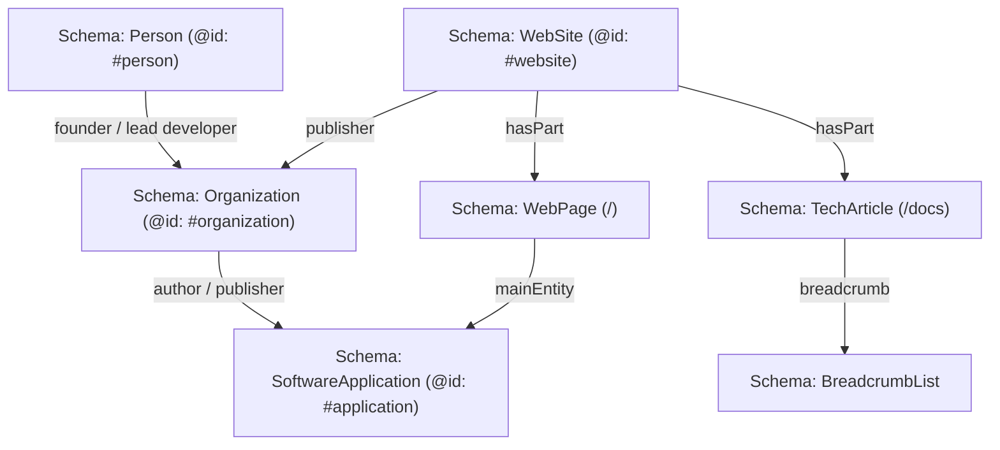

# 05 — Advanced Structured Data & Entity Schema Architecture

**Document Code:** `SEO-PHASE-05`  
**System:** Secure Environment Manager (SEM)  
**Target Domain:** `https://sem.niranjansah87.com.np`  
**Standard:** Schema.org Core Vocabulary v26, Google Search Central Structured Data Guidelines  

---

## 1. Entity Architecture & Knowledge Graph Modeling

To establish SEM as a distinct software entity in Google's Knowledge Graph and AI search models, the website implements interconnected, type-safe JSON-LD schemas using stable canonical `@id` URIs:



---

## 2. Implemented Schema.org Schemas

### 2.1 SoftwareApplication Schema (Sitewide Foundation)
*   **Target Scope:** `https://sem.niranjansah87.com.np/#application`
*   **JSON-LD Definition:**
```json
{
  "@context": "https://schema.org",
  "@type": "SoftwareApplication",
  "@id": "https://sem.niranjansah87.com.np/#application",
  "name": "Secure Environment Manager",
  "alternateName": "SEM",
  "description": "Enterprise-grade, self-hosted secrets management and environment variable synchronization platform with AES-256-GCM envelope encryption.",
  "applicationCategory": "DevOpsApplication",
  "applicationSubCategory": "SecurityApplication",
  "operatingSystem": "Linux, macOS, Windows, Docker",
  "softwareVersion": "2.0.0",
  "license": "https://opensource.org/licenses/MIT",
  "url": "https://sem.niranjansah87.com.np",
  "image": "https://sem.niranjansah87.com.np/og_default.png",
  "offers": {
    "@type": "Offer",
    "price": "0",
    "priceCurrency": "USD",
    "availability": "https://schema.org/InStock"
  },
  "author": {
    "@type": "Person",
    "@id": "https://sem.niranjansah87.com.np/#person",
    "name": "Niranjan Sah",
    "url": "https://niranjansah87.com.np/"
  },
  "featureList": [
    "AES-256-GCM 3-tier envelope encryption (MEK to KEK to DEK)",
    "Self-hosted zero-knowledge data sovereignty",
    "Multi-tenant namespace and environment isolation",
    "Append-only tamper-proof audit trails",
    "Developer CLI toolchain and TypeScript SDK",
    "Fastify + NestJS high-throughput API engine"
  ]
}
```

### 2.2 TechArticle & BreadcrumbList Schema (`/docs`)
*   **Target Scope:** `https://sem.niranjansah87.com.np/docs#article`
*   **JSON-LD Definition:**
```json
{
  "@context": "https://schema.org",
  "@type": "TechArticle",
  "@id": "https://sem.niranjansah87.com.np/docs#article",
  "headline": "Secure Environment Manager Technical Documentation & Cryptographic Architecture",
  "description": "Comprehensive guide to SEM V2: AES-256-GCM envelope encryption, key hierarchy (MEK to KEK to DEK), CLI installation, and REST API integration.",
  "inLanguage": "en-US",
  "author": {
    "@type": "Person",
    "@id": "https://sem.niranjansah87.com.np/#person",
    "name": "Niranjan Sah",
    "url": "https://niranjansah87.com.np/"
  },
  "publisher": {
    "@type": "Organization",
    "@id": "https://sem.niranjansah87.com.np/#organization",
    "name": "Secure Environment Manager",
    "url": "https://sem.niranjansah87.com.np",
    "logo": "https://sem.niranjansah87.com.np/logo.png"
  },
  "breadcrumb": {
    "@type": "BreadcrumbList",
    "itemListElement": [
      {
        "@type": "ListItem",
        "position": 1,
        "name": "Home",
        "item": "https://sem.niranjansah87.com.np/"
      },
      {
        "@type": "ListItem",
        "position": 2,
        "name": "Documentation",
        "item": "https://sem.niranjansah87.com.np/docs"
      }
    ]
  }
}
```

### 2.3 Person & Organization Entity Schema (E-E-A-T Anchor)
*   **Target Scope:** `https://sem.niranjansah87.com.np/#person`
*   **JSON-LD Definition:**
```json
{
  "@context": "https://schema.org",
  "@type": "Person",
  "@id": "https://sem.niranjansah87.com.np/#person",
  "name": "Niranjan Sah",
  "url": "https://niranjansah87.com.np/",
  "sameAs": [
    "https://github.com/niranjansah87",
    "https://www.linkedin.com/in/niranjan-sah/",
    "https://x.com/niranjan8790"
  ],
  "jobTitle": "Lead Software Architect & Security Systems Engineer",
  "knowsAbout": [
    "Cryptography",
    "Envelope Encryption",
    "DevOps Automation",
    "Secrets Management",
    "Next.js",
    "NestJS",
    "Distributed Systems"
  ]
}
```

---

## 3. Validation & Testing Protocols

1.  **Schema.org Validator (`validator.schema.org`):** Validates clean syntax, missing properties, and type inheritance.
2.  **Google Rich Results Test:** Verifies compatibility with Google Search rich snippets (`SoftwareApplication`, `BreadcrumbList`).
3.  **Strict Rule:** Never fabricate customer reviews (`AggregateRating`), fake testimonials, or price discounts. The current product is 100% open source under the MIT License with a transparent price of `$0 USD`.

