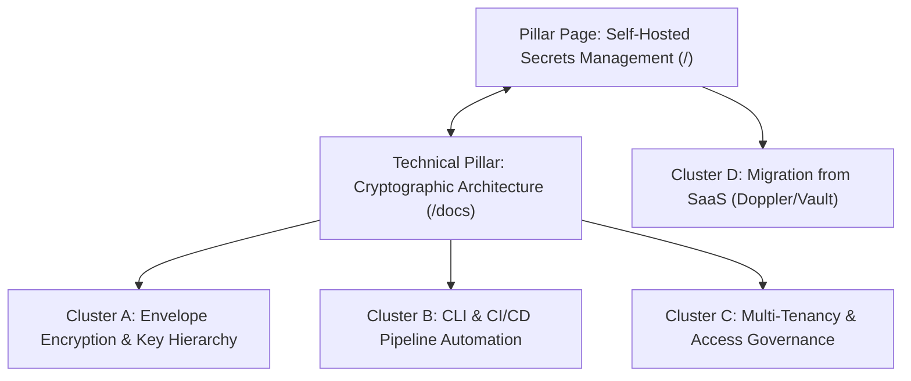

# 08 — Topical Authority & Content Engineering Strategy

**Document Code:** `SEO-PHASE-08`  
**System:** Secure Environment Manager (SEM)  
**Target Domain:** `https://sem.niranjansah87.com.np`  
**Framework:** Pillar-Cluster Topical Authority Model, E-E-A-T Editorial Standards  

---

## 1. Topical Authority & The Pillar-Cluster Model

In Google's modern semantic ranking systems, search engines do not rank pages purely on keyword density; they assess whether a domain demonstrates comprehensive coverage and domain expertise across its core entity domain: **Secrets Management & Environment Security**.

---

## 2. Topic Cluster Blueprints

### Topic Cluster A: Cryptographic Integrity & Envelope Encryption
*   **Core Entity:** AES-256-GCM Envelope Architecture
*   **Pillar Asset:** `/docs#envelope-encryption`
*   **Supporting Subtopics:**
    *   *NIST SP 800-38D Implementation:* Why GCM mode is preferred over CBC (prevents padding oracle attacks).
    *   *Key Hierarchy Separation:* Master Encryption Key (`MEK`), Project Key Encryption Key (`KEK`), and Environment Data Encryption Key (`DEK`).
    *   *Additional Authenticated Data (AAD):* Binding ciphertext to organizational IDs (`org:project:env`) to prevent ciphertext relocation attacks.

### Topic Cluster B: Developer Workflow & CI/CD Automation
*   **Core Entity:** Headless CLI Toolchain & Runtime Injection
*   **Pillar Asset:** `/docs#cli-toolchain`
*   **Supporting Subtopics:**
    *   *GitHub Actions Workflow:* Exporting encrypted secrets dynamically into runner memory.
    *   *Docker Compose Integration:* Generating ephemeral `.env` configurations without disk persistence.
    *   *Kubernetes Secrets Injection:* Sidecar injection and persistent volume mounting.

### Topic Cluster C: Enterprise Governance & Compliance
*   **Core Entity:** Tamper-Proof Audit Logging & Multi-Tenancy
*   **Pillar Asset:** `/docs#threat-model`
*   **Supporting Subtopics:**
    *   *Append-Only Audit Trails:* Logging mutation events with cryptographic actor hashes.
    *   *Role-Based Access Control (RBAC):* Granular scoping of API keys vs user accounts.
    *   *SOC2 / ISO 27001 Preparedness:* Meeting data sovereignty and access audit requirements.

---

## 3. Editorial Quality & Technical Review Guidelines

To maintain highest editorial standards and prevent thin, AI-generated spam:
1.  **Author Attribution & Bylines:** All technical guides and documentation must explicitly credit author **Niranjan Sah** with verifiable links to GitHub, LinkedIn, and personal portfolio.
2.  **Code Verification Guarantee:** Every terminal command, Dockerfile snippet, or SDK call published on the site must be validated against the active repository source code (`backend/`, `frontend/`, `packages/`).
3.  **Explicit Changelogs & Timestamps:** Use accurate ISO timestamps (`lastModified: new Date()`) and document version milestones (e.g., SEM V2 NestJS Fastify Migration).
4.  **No Thin Keyword Doorway Pages:** Rather than generating 50 duplicate location/framework pages, consolidate technical depth into robust, high-density guides that solve real developer hurdles.
